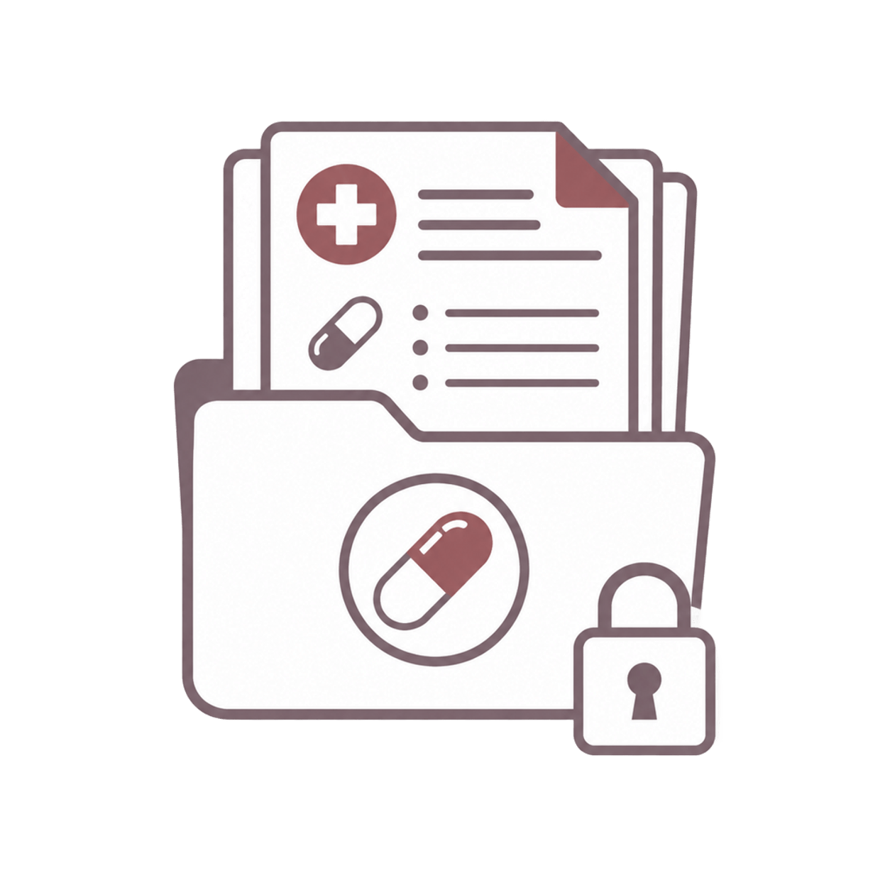

# cs_cima — Centro Sanitario: CIMA

**Versión:** 19.0.2.1.0 | **Licencia:** LGPL-3 | **Autor:** Equilibrium

Catálogo de medicamentos integrado con CIMA (AEMPS) — gratuito, sin API key.

## Descripción

Módulo Odoo 19 para centros sanitarios que integra el catálogo oficial de medicamentos de la Agencia Española de Medicamentos y Productos Sanitarios (AEMPS) a través de su API pública CIMA. Permite búsqueda, importación y gestión de medicamentos directamente desde Odoo sin necesidad de API key.

## Funcionalidades

- Catálogo de medicamentos sincronizado con CIMA/AEMPS
- Widget de búsqueda de fármacos en tiempo real
- Wizard de importación masiva desde CIMA
- Log de uso de medicamentos por residente
- Integración con prescripciones médicas
- Configuración desde ajustes generales de Odoo

## Dependencias

```
base, mail, account, cs_resident, cs_medical_care
```

## Instalación

1. Copiar el módulo en el directorio `addons` de Odoo
2. Actualizar lista de aplicaciones
3. Buscar "CIMA" e instalar

## Proyecto

Parte del ecosistema **Equilibrium** — software de gestión para centros de salud mental.
